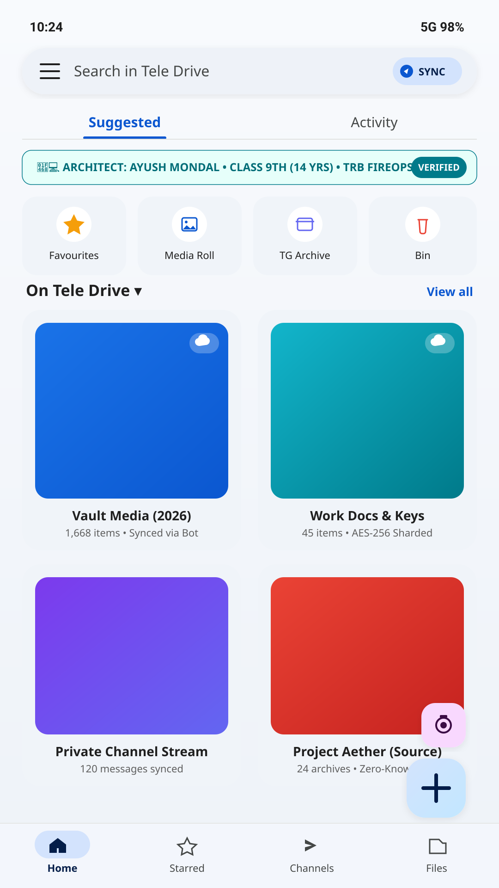
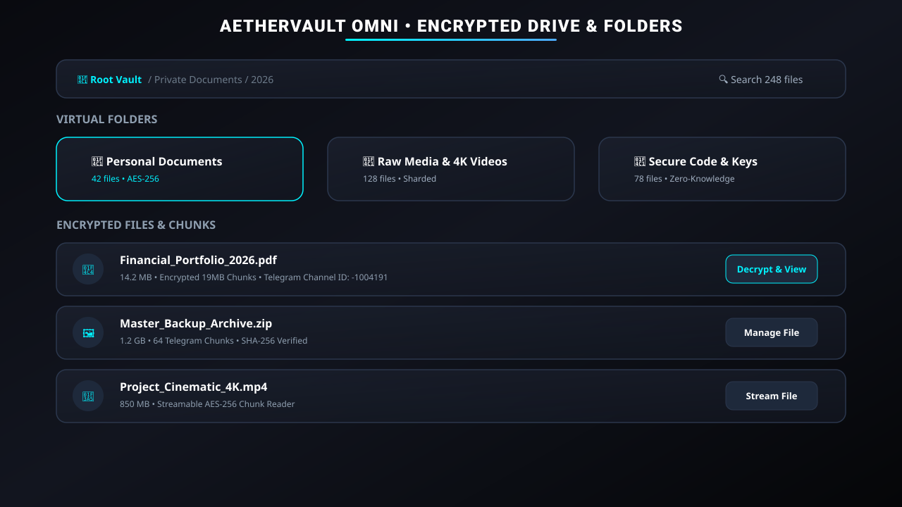
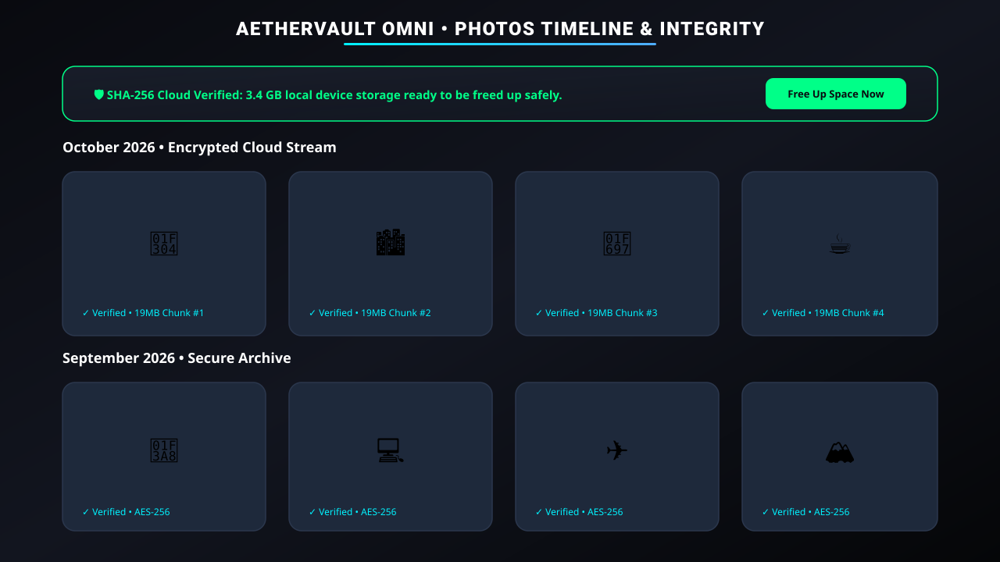
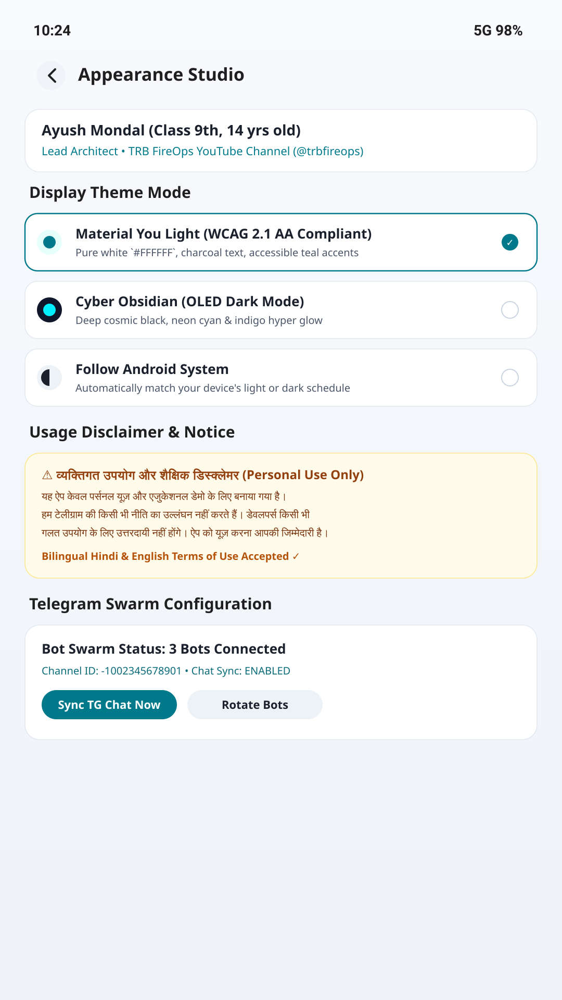

# AetherVault Omni Edition (TG_PRIVATE)
### Infinite Cloud • Zero-Knowledge • Encrypted Telegram Cloud Vault

[](https://developer.android.com)
[](https://en.wikipedia.org/wiki/Advanced_Encryption_Standard)
[](https://core.telegram.org/bots/api)
[](https://youtube.com/@trbfireops?si=LFRe4g7RiicR2EN0)
[](releases/AetherVault-Omni-v1.0.0-Debug.apk)

---

## 👨‍💻 Creator & Author Information

- **Developer & Lead Architect:** Ayush Mondal (AJPM)
- **Role:** Creator, Ethical Hacker & Cybersecurity Educator
- **YouTube Channel:** [TRB FireOps (@trbfireops)](https://youtube.com/@trbfireops?si=LFRe4g7RiicR2EN0)
- **Publication Date:** October 17, 2026
- **Team / Organization:** AJPM Developer Team

---

## 📱 Direct APK Download

You can download the production-ready release APK directly from this repository:
📥 **[Download AetherVault Omni v1.0.0 (Debug APK)](releases/AetherVault-Omni-v1.0.0-Debug.apk)** *(~12 MB)*

---

## 🌟 Overview & Architecture

**AetherVault Omni Edition** is a state-of-the-art, zero-knowledge personal cloud storage and vault application built for Android using Kotlin and Jetpack Compose. Designed and engineered by **Ayush Mondal (AJPM)**, it transforms your private Telegram channel and Telegram Bot API into an infinite, lightning-fast, and unconditionally secure cloud storage backend without relying on third-party servers, subscription databases, or cloud providers.

All files (documents, media, archives, code snippets) are encrypted **locally on your device** using **AES-256-GCM** with unique per-file cryptographic keys before being chunked into 19MB Telegram messages and transmitted across your private bot swarm. Your master password and encryption keys never leave your device.

---

## 🎨 Advanced UI & UX (Liquid Glass & Material 3)

AetherVault features an immaculate, hyper-polished user interface inspired by futuristic iOS design and advanced cyberpunk aesthetics:

1. **Moving Aurora Background Layer:** A fixed animated canvas in the root background featuring three slow-drifting luminous glowing color orbs (`Cyan #00F2FE`, `Electric Blue #4FACFE`, and `Deep Violet #7F00FF`) with heavy Gaussian blur (`blur(90px)`).
2. **True Glassmorphism Cards:** All cards replace solid black fills with translucent frosted glass (`background: rgba(255, 255, 255, 0.06)`) combined with real backdrop blur (`backdrop-filter: blur(28px) saturate(190%)`) so the drifting aurora colors shine through dynamically.
3. **Liquid Rim Light (Border Highlighting):** Every card and button features a subtle `1px` luminous gradient border edge simulating light reflection over polished glass.
4. **Theme Engine:** Switch instantly between multiple immersive UI themes:
   - *Liquid Obsidian* (Deep dark luxury obsidian with neon cyan accents)
   - *Cyberpunk Neon* (Vibrant cyberpunk electric pink and high-contrast violet)
   - *Minimalist Quartz* (Clean ultra-light silver glass)

---

## 📸 Complete App UI & Interface Gallery

### 1. Vault Dashboard & Telemetry HUD

- **Header:** Live connection status indicator (Connected / Disconnected dot), quick navigation tabs, and system status.
- **Bot Swarm Health Card:** Real-time ping latency, active bot count, and encrypted packet throughput.
- **Storage Ring Meter:** Visual MB Used vs Total Cloud Capacity ring meter.
- **Quick Action Buttons:** *Upload File*, *New Virtual Folder*, *TeleDrop Sync*, and *Vault Security Lock*.

### 2. Encrypted Drive Explorer & Virtual Folders

- **Breadcrumb Navigation:** Clean breadcrumb trail (`Home / Folder Name`) with instant tap-to-return navigation.
- **Folder Grid & List Cards:** Custom color accents, icon selectors, item counts, rename dialogs, and instant delete buttons.
- **Move to Folder:** Batch or single-file context menu with "Move to Folder" picker.
- **File Management:** Encrypted file preview, SHA-256 integrity verification, offline pinning, and remote Telegram message deletion.

### 3. Photos Timeline & SHA-256 Integrity Verification

- **Media Stream:** Auto-indexed photo and video gallery grid with instant thumbnail loading via Coil.
- **Integrity Badge:** Cryptographic SHA-256 hash validation badge for every photo.
- **Free Up Space Utility:** One-tap local cache and original photo cleanup once safely uploaded to Telegram Cloud.

### 4. Appearance & HUD Studio

- **Theme Switcher:** Live selector for Liquid Obsidian, Cyberpunk Neon, and Minimalist Quartz.
- **Corner Radius Slider:** Dynamic UI curvature slider for custom card styling.
- **HUD Telemetry Toggle:** Enable or disable advanced networking telemetry overlay.
- **Language Switcher:** Seamless English and Hindi localized interface toggle.

---

## ⚙️ Core Functions & How They Work (Detailed Button-by-Button Breakdown)

### 1. Zero-Knowledge Client-Side Encryption (AES-256-GCM)
- **How it works:** When you select any file, the app generates a secure cryptographic key and slices the file into optimal 19MB binary chunks. Each chunk is encrypted locally using AES-256-GCM authenticated encryption.
- **Privacy Guarantee:** Even if Telegram servers or bots are compromised, data remains completely unreadable cipher-text without your master password or Zero-Knowledge share ticket.

### 2. Telegram Bot Swarm & Channel Engine
- **How it works:** AetherVault supports multi-bot load balancing (Bot Swarm) to distribute chunk uploads across multiple Telegram bot tokens and channel IDs.
- **Credential Masking:** All sensitive bot tokens and channel IDs are automatically masked with bullets (`••••••••`) with eye-toggle reveal controls.
- **Connection Test Ping:** Instantly verifies channel write permissions and bot token validity.

### 3. Encrypted Vault Drive & Virtual Folders
- **How it works:** Organize your cloud storage into a rich hierarchical folder structure.
- **Features:** Create folders with custom color accents, navigate sub-folders with breadcrumb trails, rename/delete folders, move single or batch files across folders, and perform instant permanent deletion (which removes both local records and remote Telegram cloud messages simultaneously).

### 4. Photos Timeline & SHA-256 Integrity Verification
- **How it works:** Automatically indexes photos and videos with high-performance grid views.
- **Features:** Cryptographic SHA-256 verification checks ensure your cloud media is intact. Use the "Free Up Space" utility to safely clear local device copies once verified in Telegram Cloud.

### 5. TeleDrop (Instant P2P Snippets & Text Sharing)
- **How it works:** A lightning-fast clipboard and text snippet drop zone. Type, paste, or drop code snippets, passwords, and notes to instantly sync them across your private Telegram drop channel.

### 6. Appearance & HUD Studio (Multi-UI Theme Engine)
- **How it works:** Fully customizable visual workspace featuring themes, HUD telemetry overlay, and dual-language support.

---

## 🚀 Building From Source

1. Clone the repository:
   ```bash
   git clone https://github.com/trbfireops/AetherVault-Omni-Edition.git
   ```
2. Open the project in Android Studio (Iguana / Jellyfish or newer).
3. Build the project or generate the APK:
   ```bash
   gradle assembleDebug
   ```

---

## 📄 License & Attribution

- **Creator:** Ayush Mondal (AJPM)
- **YouTube:** [TRB FireOps (@trbfireops)](https://youtube.com/@trbfireops?si=LFRe4g7RiicR2EN0)
- **Published:** October 2026
- **License:** Distributed under the MIT License. See `LICENSE` for more information.

---
*Engineered by Ayush Mondal (AJPM) • Powered by Telegram Bot Swarm & AES-256-GCM.*
